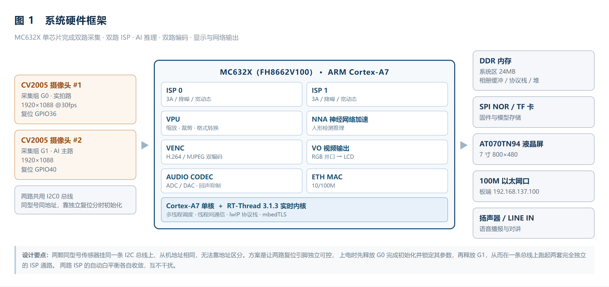
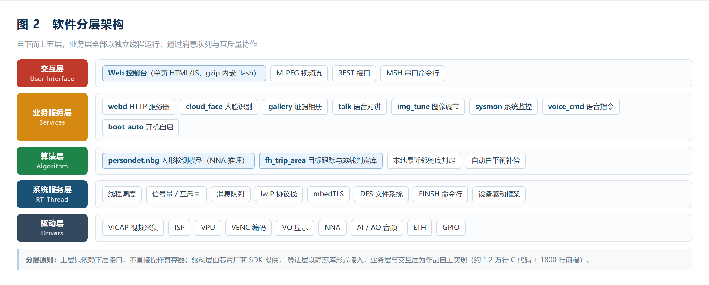
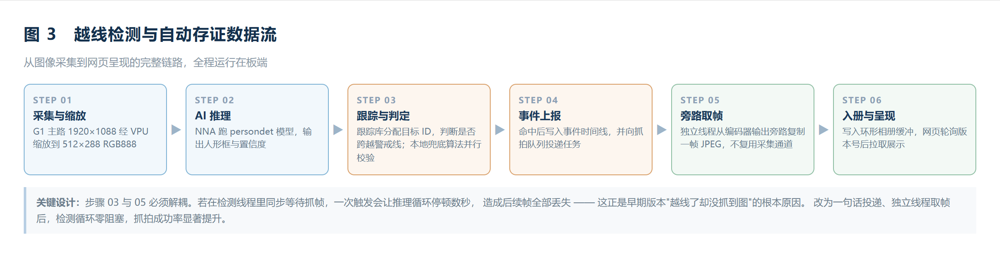

# SENTINEL · 基于 RT-Thread 的双目 AI 视觉安防终端

**RT-Thread 2026 嵌入式大赛参赛作品** ｜ 硬件平台 **富瀚微 MC632X（ARM Cortex-A7）** ｜ RTOS **RT-Thread 3.1.3**


---

## 简介

**SENTINEL 是一台脱离 PC 独立运行的双目 AI 视觉安防终端。** 它只用一根电源线和一根网线，上电后自动完成网络配置、媒体管线启动、Web 服务启动与对时；现场只需打开浏览器访问 `http://<板端IP>:8080`，全部交互都收敛在板端下发的单个网页里，无需安装任何客户端。

作品要解决的不是"把功能堆在一起"，而是资源受限嵌入式平台上的三个真实矛盾：

| 矛盾 | 常规做法 | 本作品的做法 |
| --- | --- | --- |
| 单摄难以兼顾画质与算法 | 降分辨率喂算法，人眼看不清 | **双摄分路**：G0 1080P 供人看，G1 800×480 专喂神经网络 |
| AI 推理与视频编码抢资源 | 全塞 CPU，开 AI 就卡 | 推理、编码、缩放全走 **VPU / VENC / NN 硬件单元**，CPU 只做调度 |
| 报警只有框没有证据 | 框消失什么都不留 | **越界即落盘**：判定命中立刻抓帧进证据相册，可回溯、可举证 |

---

## 功能

- **双路独立成像** — 两颗 CV2005 各自一套 ISP（G0 1080P@30 / G1 1080P@15），实拍路 MJPEG 推流给网页，AI 主路专供算法；两路白平衡独立基线，互不串色
- **板端人形检测** — 板载 NN 加速器跑 `persondet` 模型（512×288 RGB888 输入），不依赖云端算力
- **绊线越界判定与自动存证** — `fh_trip_area` 跟踪库做目标框跟踪与越线判定，命中瞬间抓帧入册并记录事件，双路判定降低漏报
- **证据相册** — 50 槽环形缓冲，支持分页浏览、单张删除、一键清空，缩略图带时间戳与文件大小
- **云端人脸识别** — 板端只负责抓帧与登记，比对交给局域网 PC（OpenCV LBPH）或讯飞人脸库，返回姓名 / 距离 / 耗时；识别结果超过 15s 自动标记"已过期"
- **图像参数在线整定** — 亮度、对比度、饱和度、RGB 三路增益、镜像翻转、白平衡全部网页可调、实时生效，**改参数不用重新烧固件**；一键校色把两路 ISP 拉回出厂基线
- **语音指令** — 录 5 秒 → 板端 VAD 端点检测 → 讯飞听写（WebSocket）→ 文本回填网页；录音窗口从"人声起点"开始算，归一化采用削顶预算而非整段峰值
- **浏览器语音对讲** — 半双工按住说话，上行 `/api/mic` 取 WAV、下行 `/api/talkdown` 推裸 PCM；常驻采集线程 + 双写环形缓冲，避免每次开关 ACODEC 触发 4.5s 直流伺服
- **系统监控与看门狗** — CPU 占用（调度钩子 + 1MHz 计数器，扣除中断耗时）、内存、运行时长、峰值堆；5 条关键线程心跳 + 20s 硬件看门狗，卡死自动复位
- **全流程开机自启** — 7 步启动链（网卡 → 媒体管线 → Web → 抓拍 → 人脸 → 对时 → 绊线），`boot` 命令可查看每步状态或单独重做

---

## 硬件 / 软件

| 项目 | 说明 |
| --- | --- |
| 主控 | MC632X（FH8662V100），单核 ARM Cortex-A7 |
| 传感器 | 双 CV2005，同型号同地址，靠独立复位引脚 GPIO36 / GPIO40 分时初始化 |
| 内存 / 存储 | DDR 24MB 系统内存；SPI NOR 存放固件与模型 |
| 显示 | AT070TN94 7 寸 800×480，走 VO 视频层 |
| 网络 | 100M 以太网，板端固定 IP 可配 |
| 音频 | 板载 AUDIO CODEC；输入仅 LINE IN（板载咪头弃用） |
| 操作系统 | RT-Thread 3.1.3（`RT_THREAD_PRIORITY_MAX=256`，tick 100Hz，开启 VFP / SLAB / 软件定时器 / 栈溢出检查） |
| 中间件 | lwIP（`MEM_SIZE=64KB`）、mbedTLS、FatFS、finsh |
| 算法 | `persondet.nbg` 人形检测模型 + `libtrip_area_arm_rtt.a` 跟踪判定库 |
| 云服务 | 讯飞语音听写（WebSocket）、讯飞人脸库 / 自建 PC LBPH 服务 |

### 端口一览

| 端口 | 用途 |
| --- | --- |
| 8080 | 板端 HTTP 服务器 `webd`，网页控制台与全部 REST 接口 |
| 1111 | 实拍画面 MJPEG（G0 1080P） |
| 1112 | AI 主路 MJPEG（G1 800×480） |
| 1252 / 1258 / 1260 | RTSP 各通道（TCP only，客户端需加 `--rtsp-tcp`） |

---

## 系统架构

**图 1 · 系统硬件框架**



**图 2 · 软件分层架构**



**图 3 · 越线检测与自动存证数据流**



### 线程规划（16 条常驻线程）

| 优先级 | 线程 | 栈 | 职责 |
| --- | --- | --- | --- |
| 8 | `rt_timer` | — | 软件定时器 |
| 12 | `cf_face` | 16KB | 人脸任务队列（抓帧 / 登记 / 识别） |
| 12 | `talk` | 4KB | 对讲常驻采集 |
| 12 | `voice` | 16KB | 语音指令状态机（VAD + ASR） |
| 13 | `tkdown` | 4KB | 对讲下行播放 |
| 14 | `nna_ivs` | 256KB | NN 推理 + 绊线判定 |
| 15 | `bootnet` | 4KB | 网络自启 |
| 20 | `dog` | 2KB | 心跳巡检 + 喂硬件狗 |
| 20 | `tshell` | 15KB | finsh 命令行 |
| 25 | `webd` | 8KB | HTTP 服务（单线程、无 select、无 malloc） |
| 26 | `evi` | 6KB | 证据抓拍与相册管理 |
| 100 | `tcpip` | 8KB | lwIP 协议栈 |
| 126 | `erx` / `etx` | 1KB | 网卡收发 |
| 255 | `tidle` | 1KB | 空闲 |

同步点共 8 处：4 个二值信号量、2 个互斥量（带优先级继承）、3 处临界区；未使用事件集 / 邮箱 / 消息队列，避免不必要的内核对象开销。

---

## 目录结构

```
SENTINEL/
├── app/                          # 应用层代码，对应原厂 SDK 的 app/media_demo/
│   ├── web/                      # 板端 Web 服务与网页控制台
│   │   ├── src/webd.c            #   HTTP 服务器（单线程 / 8KB 栈 / 无 malloc）
│   │   ├── src/img_tune.c        #   ISP 图像参数在线整定（两路独立 AWB 基线）
│   │   ├── src/gallery.c         #   50 槽环形证据相册 + 抓拍线程
│   │   ├── src/talk.c            #   语音对讲（双写环形缓冲）
│   │   ├── src/sysmon.c          #   CPU / 内存统计
│   │   ├── src/dog.c             #   线程心跳 + 硬件看门狗
│   │   ├── src/web_index_gz.c    #   网页资源（由 webui/index.html 打包生成）
│   │   ├── webui/index.html      #   单页控制台源码
│   │   └── tools/pack_web.py     #   把 index.html 压缩打包成 web_index_gz.c
│   ├── cloud_face/               # 云端人脸识别客户端
│   │   ├── src/cloud_face.c      #   任务队列 / 抓帧 / 登记 / 识别
│   │   ├── src/cf_http.c         #   极简 HTTP 客户端（libcurl 太重）
│   │   └── tools/face_server.py  #   PC 侧比对服务（OpenCV LBPH）
│   ├── voice_asr/                # 讯飞语音链路
│   │   ├── audio_capture.c       #   采集 / 归一化 / 播放
│   │   ├── voice_cmd.c           #   语音指令状态机
│   │   ├── xf_http_asr.c         #   讯飞一句话识别
│   │   └── ws_client.c           #   手写 WebSocket（SDK 的 libcurl 7.67 不支持 WS）
│   ├── startup/                  # 开机自启
│   ├── sample_demo/nna_app/src/  # NN 推理 + 绊线越界判定
│   ├── script/rtt/               # 构建脚本（模块挂载）
│   ├── .config / config.h        # 构建配置（两处必须同步修改）
│   └── ...
├── docs/
│   ├── 作品说明书.md              # 完整技术文档（约 1.9 万字）
│   ├── 演示视频脚本.md            # 分镜脚本
│   ├── SENTINEL_网页演示_字幕.srt
│   └── images/                   # 架构图
├── LICENSE
└── README.md
```

> **本仓库不含富瀚微原厂 SDK。** 原厂 SDK（驱动、中间件、算法库、`persondet.nbg` 模型）受其授权条款约束，未随仓库分发，请向芯片原厂或赛事主办方获取。

---

## 快速开始

### 1. 准备 SDK

获取 **Fullhan RT-Thread SDK V3.4.0**，得到如下目录：

```
rt-thread/
├── app/media_demo/      ← 本仓库 app/ 的内容覆盖到这里
├── drivers/  kernel/  net/  lib/  platform/  ...
└── Makefile
```

### 2. 覆盖应用代码

```bash
# 在 SDK 根目录执行，把本仓库的 app/ 覆盖到 app/media_demo/
cp -r SENTINEL/app/. rt-thread/app/media_demo/
```

覆盖后至少确认这几个文件是**本仓库版本**（而不是原厂示例）：

```bash
ls app/media_demo/web/src/          # 应有 webd.c / img_tune.c / gallery.c / talk.c / sysmon.c / dog.c
ls app/media_demo/cloud_face/src/   # 应有 cloud_face.c / cf_http.c
ls app/media_demo/startup/          # 应有 boot_auto.c
```

### 3. 配置与编译

进入 `app/media_demo` 目录：

```bash
cd app/media_demo
make clean
make
```

固件生成在 `out/bin/`。

> ⚠️ **不要执行 `make mc632x_defconfig`**。它会把这些自定义开关全部重置掉（TFTP / VBUS / VIDEO / MBEDTLS / LIBCURL / `FH_APP_OPEN_IVS` 等）。本项目所有开关**直接改 `.config` 与 `config.h`**，二者必须同步——`.config` 是构建系统的变量来源，`config.h` 是编译期宏定义。
>
> 另外 SDK 全局开启 `-Werror`，任何未使用函数、隐式声明都会中断编译。改动 `.h` 后记得同步到编译副本。

### 4. 烧录

板端走 TFTP：先 `tftp` 拉取 `out/bin/` 下的固件，再用 `${filesize}` 擦除写入。串口默认 115200。

### 5. 上电自启

烧录后复位，串口会打印 7 步启动日志。浏览器访问 `http://192.168.137.100:8080`（IP 按现场网段调整）。

---

## 使用前必改

| # | 要改什么 | 位置 | 说明 |
| --- | --- | --- | --- |
| 1 | **讯飞凭证** | `app/voice_asr/xf_http_asr.h` | 仓库内为 `YOUR_APPID / YOUR_API_KEY / YOUR_API_SECRET` 占位符，填自己的三项；也可用 `-DXF_APPID=\"...\"` 编译宏覆盖。**密钥切勿提交** |
| 2 | 板端网络 | 运行时 `ifconfig e0 192.168.137.100` + `dns 192.168.137.1` | 该配置重启即丢，如需固化请改 `boot_auto.c` |
| 3 | PC 人脸服务地址 | `app/cloud_face/src/cloud_face.c` 中的服务端 IP | 默认走局域网 PC；改用讯飞人脸库需切换 `g_mode` |
| 4 | 人形检测模型 | 板端 `./models/persondet.nbg` | 模型不随仓库分发，需自行放到板端可访问路径，否则 NN 线程启动后自动退出 |

---

## 板端接口

网页与所有外部工具都通过 `webd` 暴露的接口交互：

| 接口 | 方法 | 说明 |
| --- | --- | --- |
| `/` | GET | 网页控制台（gzip 单页，约 22KB） |
| `/api/state` | GET | 全量状态快照：双路画面、人脸、语音、CPU/内存、相册、事件 |
| `/api/cmd` | GET | 控制台命令透传（如 `vlcview -p 1246`） |
| `/api/face` | GET | 人脸识别 / 强制解锁 / 重置忙标志 |
| `/api/enroll` | POST | 人脸登记（姓名 + 可选上传照片） |
| `/api/img` | GET | 图像参数读写：`k=brt\|crt\|sat\|rgn\|ggn\|bgn\|mir\|flp\|wb\|reset` |
| `/api/snap` | GET | 手动抓拍一张入相册 |
| `/api/gallery` | GET | 相册列表 / 分页 / 删除 / 清空 |
| `/api/evi` / `/api/evt` | GET | 证据图取流 / 事件时间线 |
| `/api/talk` | GET | 对讲会话控制 |
| `/api/mic` | GET | 上行取音（WAV，`sec=N`） |
| `/api/talkdown` | POST | 下行推裸 PCM（≤ 24KB） |
| `/ping` | GET | 心跳 |

> 注意：除 `/api/enroll`、`/api/talkdown` 外均为 **GET**（网页里的 `post()` 实际发的是 GET）。

### 串口调试命令

| 命令 | 作用 |
| --- | --- |
| `boot [net\|web\|trip\|time]` | 查看 / 重做自启动步骤 |
| `trip [x N]`、`trip dbg on` | 查看移动警戒线、打开逐帧判定输出 |
| `img [dump\|sel N\|neutral\|auto]` | 图像参数导出、切通道、一键校色 |
| `face [enroll\|probe\|list]` | 人脸登记 / 识别 / 名单 |
| `cpu [top\|burn N\|res]` | CPU 占用、分线程统计、满载自检 |
| `webd [start\|stop\|status]` | Web 服务控制 |
| `voice_test [sec]` | 一次性语音识别测试（含底噪 / SNR 诊断） |
| `dog [on\|off\|dump]` | 看门狗开关与各线程心跳年龄 |

---

## 实测数据

| 指标 | 数值 |
| --- | --- |
| 实拍路 / AI 主路帧率 | 30fps / 15fps |
| 人形检测帧率 | 5 ~ 15fps |
| 越界抓拍延迟 | < 400ms |
| 人脸单次识别耗时 | 60 ~ 130ms |
| CPU 占用（双路 + NN + Web 全开） | 约 26% |
| 内存占用 | 3.1MB / 15.3MB |
| 证据相册容量 | 50 张环形 |

---

## 常见问题

**Q：网页打得开但画面一直转圈？**
先确认媒体管线启动了（`vlcview -p 1246`）。1252 及以上端口全不通，说明整条管线没起。

**Q：抓拍/识别一直失败，提示 `ERR:no-mjpeg`？**
同上，抓帧依赖编码器出流，必须先让 AI 主路跑起来。

**Q：人脸识别结果恒为"未知"？**
检查返回的 `cap` 字段：`recognition` 才是真的在建库比对。另外注意 `known`（照片数）≠ `indexed`（真正可识别的人数），检不到人脸的登记照永远不会被认出。

**Q：RTSP 拉不到流？**
只支持 TCP，VLC 需加 `--rtsp-tcp`。

**Q：改了网页没变化？**
网页资源是编译期打成 C 数组的，改完 `webui/index.html` 必须重跑 `web/tools/pack_web.py` 生成 `web_index_gz.c`，再重新编译烧录。

---

## 文档与演示

- 完整技术文档：[docs/作品说明书.md](docs/作品说明书.md)（约 1.9 万字，含设计取舍、线程规划、内存布局、测试记录）
- 演示分镜脚本：[docs/演示视频脚本.md](docs/演示视频脚本.md)
- 网页演示字幕：[docs/SENTINEL_网页演示_字幕.srt](docs/SENTINEL_网页演示_字幕.srt)

---

## 致谢

- 富瀚微 MC632X SDK V3.4.0 提供的驱动层与硬件抽象
- RT-Thread 团队的实时内核、lwIP 适配与 finsh 组件
- 讯飞开放平台提供的语音听写与人脸能力

## License

[MIT](LICENSE) © 2026 SENTINEL Project

> 原厂 SDK、算法库与检测模型不在本仓库范围内，其使用请遵循各自授权条款。
