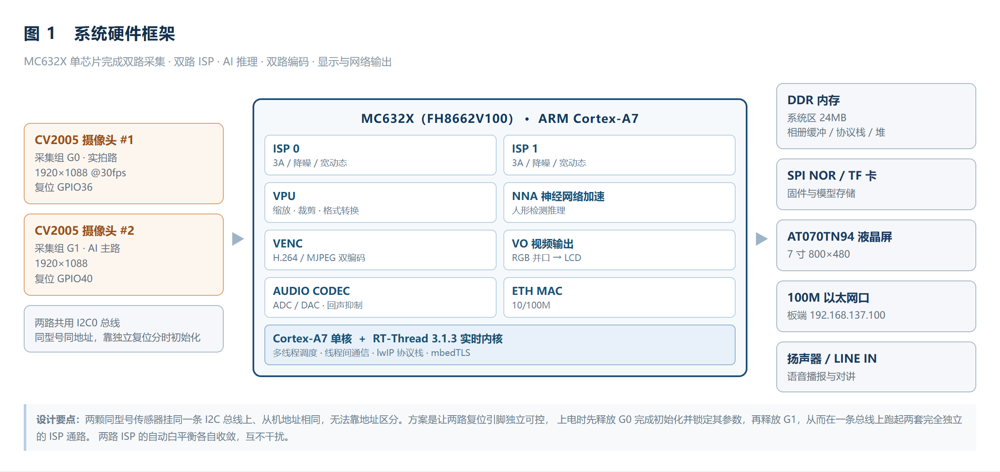
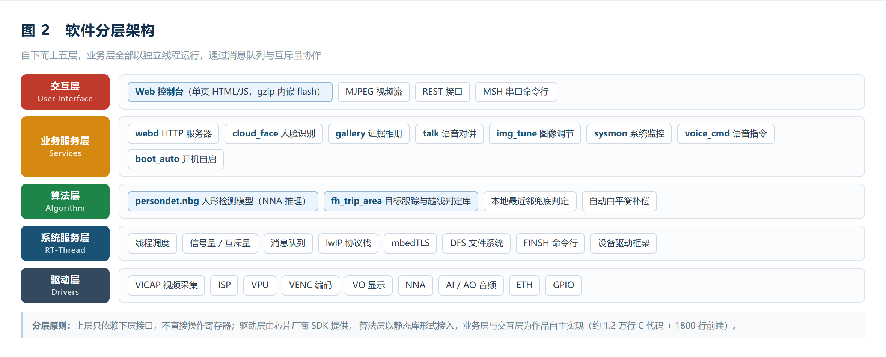
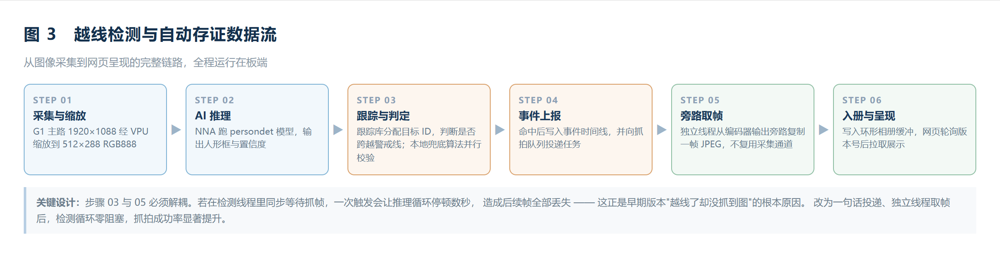

# SENTINEL：基于 RT-Thread 的双目 AI 视觉安防终端

**作品说明书**

> 参赛方向：嵌入式电子设计
> 操作系统：RT-Thread 3.1.3
> 硬件平台：富瀚微 MC632X（ARM Cortex-A7）
> 文档版本：V1.0

---

## 摘要

本作品以一颗高度集成的国产视觉 SoC——MC632X 为核心，在 RT-Thread 实时操作系统之上构建了一台**脱离 PC 独立运行**的双目 AI 视觉安防终端。设备同时驱动两颗图像传感器，形成"实拍路"与"AI 主路"两条独立的成像通路：实拍路负责提供高保真的现场画面，AI 主路专门服务于神经网络推理与目标跟踪，二者互不干扰。

在功能层面，作品实现了人形检测、绊线越界判定、越界自动抓拍存证、云端人脸识别、图像参数在线整定、语音指令控制、浏览器语音对讲、系统资源监控以及全流程开机自启动。所有交互都收敛到一个由板端 HTTP 服务器直接下发的网页控制台上，现场部署时只需一根网线和一个浏览器，无需安装任何客户端软件。

作品的价值不在于把若干功能简单叠加，而在于系统性地解决了资源受限嵌入式平台上的三个真实矛盾：**双摄与单总线的矛盾**、**AI 推理与视频编码争抢通道的矛盾**、**实时检测与同步 IO 阻塞的矛盾**。围绕这些矛盾所做的工程设计，构成了本文档第四章的技术主体。

自主实现的核心代码约 1.57 万行，其中 C 语言 8 300 余行、前端单页 1 780 行、配套工具脚本 800 行。

---

## 一、项目概述

### 1.1 作品简介

SENTINEL 是一台部署在边缘侧的智能视觉终端。它不依赖云端算力完成基础判断，而是把"看得见、认得准、记得住、说得出"这四件事全部收敛到板端：

- **看得见**——双路摄像头同时在线，一路高保真供人眼查看，一路专门喂给神经网络；
- 认得准——板载 NPU 运行人形检测模型，配合自研的越界判定逻辑，把"画面里有个人"升级为"这个人越过了警戒线"；
- 记得住——判定命中的瞬间自动留取一张现场图，连同时间戳一起进入可翻页、可删除的证据相册；
- 说得出——支持语音指令与浏览器语音对讲，现场无需操作任何设备即可完成交互。

设备整机只需 5V 供电与一根网线。上电后自动完成网络配置、媒体管线启动、Web 服务启动与时间同步，操作人员打开浏览器输入地址即可使用。

### 1.2 设计背景与痛点

在调研市面上的消费级网络摄像机与开源视觉方案后，我们归纳出四个尚未被很好解决的痛点：

**痛点一：单摄方案难以兼顾"画质"与"算法"。**
主流 IPC 只有一颗传感器，AI 推理所需的图像与用户观看的图像来自同一路码流。为了让算法跑得动，往往要把分辨率压到 640×360 甚至更低，导致用户看到的画面模糊；而一旦提高分辨率，推理帧率又掉到无法接受的水平。二者只能取其一。

**痛点二：边缘算力有限，AI 与编码互相抢资源。**
许多方案把推理、编码、网络传输全部塞进同一颗 CPU，结果是"开了 AI 视频就卡，视频流畅了 AI 就不准"。这本质上是没有把硬件加速器用对地方。

**痛点三：报警只有框，没有证据链。**
绝大多数开源方案在检测到目标时只在前端画一个矩形框，框消失后什么都没留下。一旦需要回溯"昨天晚上十点有没有人来过"，系统拿不出任何材料。真正的安防价值在于**可举证的留痕**，而不在于实时的框。

**痛点四：现场部署门槛高。**
参数调节依赖 PC 端专用软件或串口命令行，普通使用者根本无从下手。一次现场调试往往需要工程师带着笔记本到场。

### 1.3 设计目标与达成情况

| 序号 | 设计目标 | 量化指标 | 达成情况 |
| --- | --- | --- | --- |
| 1 | 双路图像同时在线且互不干扰 | 双路独立 ISP，帧率不低于 15fps | 已达成，实拍路 30fps、AI 主路 15fps |
| 2 | 板端完成人形检测，不依赖云端 | 检测帧率 ≥ 5fps | 已达成，实测 5~15fps |
| 3 | 越界判定准确且不漏报 | 单次越界必留痕 | 已达成，双重判定机制 |
| 4 | 留证图片可回溯、可管理 | 容量 ≥ 50 张，支持分页与删除 | 已达成，50 槽环形相册 |
| 5 | 全部交互通过浏览器完成 | 零客户端安装 | 已达成，单页 Web 控制台 |
| 6 | 支持语音输入与远程对讲 | 浏览器原生麦克风 | 已达成，半双工对讲 |
| 7 | 上电即用，无需人工干预 | 开机自动拉起全链路 | 已达成，7 步自启动序列 |

### 1.4 主要技术指标

| 项目 | 指标 |
| --- | --- |
| 主控芯片 | 富瀚微 MC632X（FH8662V100），单核 ARM Cortex-A7 |
| 操作系统 | RT-Thread 3.1.3 实时内核 |
| 图像传感器 | 2 × CV2005，最高 1920×1088 |
| 实拍路输出 | 1920×1088 @30fps，MJPEG，HTTP 端口 1111 |
| AI 主路输出 | 800×480，MJPEG，HTTP 端口 1112 / RTSP 端口 1260 |
| 本地显示 | AT070TN94 7 寸 800×480，H.264 硬解直通视频层 |
| 推理输入 | 512×288 RGB888，NPU 硬件加速 |
| 检测帧率 | 5~15fps（随场景复杂度浮动） |
| 证据相册 | 50 槽环形缓冲，单张上限 96KB，总占用约 4.8MB |
| 事件日志 | 24 条环形时间线 |
| 系统内存 | DDR 系统区 24MB，堆可用约 14.8MB |
| CPU 占用 | 5%~15%（1μs 精度调度统计） |
| 人脸比对 | LBPH 纹理特征，判定阈值 85 |
| Web 前端 | 单页应用，gzip 压缩后 22 131 字节，内嵌固件 |
| 自主代码量 | 约 1.57 万行 |

---

## 二、系统总体方案

### 2.1 硬件框架



整机硬件围绕 MC632X 这颗 SoC 展开。该芯片把双路 ISP、视频处理单元、神经网络加速器、视频编码器、音频编解码器与以太网 MAC 全部集成在片内，因此外围电路极为精简：两颗传感器、一片 DDR、一片 SPI NOR、一块液晶屏、一个网口、一路音频输入输出，即可构成完整系统。

#### 2.1.1 主控芯片

MC632X 的核心是一颗 ARM Cortex-A7。RT-Thread 运行在这颗核上，负责线程调度、协议栈、文件系统与全部业务逻辑。需要强调的是，**这颗 CPU 并不承担视频编码与神经网络推理**——这两项工作分别由片内的 VENC 硬件编码器和 NNA 神经网络加速器完成。CPU 只做数据搬运、逻辑判断和协议处理。这一分工是整机能够在低主频下同时跑通双路视频与 AI 推理的根本原因，也解释了后文性能测试中 CPU 占用率始终不高的现象。

#### 2.1.2 双摄像头子系统

双摄是本作品硬件设计上最关键、也最棘手的一环。

两颗 CV2005 传感器型号相同、挂载在同一条 I2C0 总线上、从机地址也完全相同。按照常规思路，一条总线无法同时服务两个同地址设备。我们采用的方案是**利用独立的复位引脚实现分时初始化**：

- 传感器 G0 的复位引脚接 GPIO36，G1 的复位引脚接 GPIO40；
- 上电后先将 G1 保持在复位状态，只释放 G0，完成 G0 的全部寄存器配置与锁定；
- 随后释放 G1，再走一遍初始化流程。

由于初始化完成后传感器的配置是锁存在各自芯片内部的，后续两路可以并行工作、互不干扰。这条经验后来被固化进驱动层，成为双摄方案能够成立的前提。

两路传感器各自拥有一套完整的 ISP 通路（ISP0 / ISP1），自动曝光、自动白平衡、降噪、宽动态全部独立收敛。这一点非常重要：如果两路共用一套 3A 参数，由于两颗镜头的光学特性存在个体差异，必然出现一路偏暖、一路偏冷的现象。事实上，作品在调试阶段确实遇到过这个问题——实测两路的红绿比分别为 1.025 和 1.220，色差明显。解决方案见 4.2 节。

#### 2.1.3 视频通道规划

MC632X 支持按"采集组 + 通道号"的方式切分多路码流。本作品的通道规划如下表，这套规划是整机资源分配的基础：

| 采集组 | 通道 | 分辨率 | 编码格式 | 用途 | 对外端口 |
| --- | --- | --- | --- | --- | --- |
| G0 | CH0 | 1920×1088 | MJPEG | 网页"实拍画面" | HTTP 1111 |
| G1 | CH0 | 1920×1088 | H.264 | 本地液晶屏、RTSP 推流 | RTSP 1258 |
| G1 | CH1 | 800×480 | MJPEG | 网页"AI 主路"、抓拍取帧源 | HTTP 1112 / RTSP 1260 |
| G1 | CH2 | 512×288 | RGB888 | 神经网络推理输入 | 不对外 |

这里有一个必须注意的约束：同一路编码通道在同一时刻只能选择一种编码格式。因此"网页上看 AI 主路"与"用 RTSP 拉 AI 主路"被安排在了同一路 800×480 的 MJPEG 码流上，而给本地屏幕用的 1080P 画面则走独立的 H.264 通道。这样既保证了屏幕上的画面清晰度，又不会与网页预览争抢带宽。

#### 2.1.4 显示、音频、网络与存储

- **显示**：AT070TN94 液晶屏通过 SoC 的视频输出层直通显示，不经过图形层合成，因此画面无撕裂、无额外内存开销。
- **音频**：板载咪头因硬件损坏无法使用，改用 LINE IN 模拟输入作为唯一音频源，输出经功放接扬声器。软件侧按单输入源处理，采集与播放共用一路 CODEC 通道。
- **网络**：100M 以太网，板端固定地址 192.168.137.100，与 PC 直连或经交换机接入局域网。
- **存储**：固件与 AI 模型存放于 SPI NOR；证据图片当前存放于 DDR 中的环形缓冲，掉电即失，长期存证通过网页下载到本地完成。这一取舍的原因见第六章的说明。

### 2.2 软件框架



软件采用五层结构，自下而上依次为驱动层、系统服务层、算法层、业务服务层与交互层。

| 层次 | 组成 | 职责 | 来源 |
| --- | --- | --- | --- |
| 交互层 | Web 控制台、MSH 命令行 | 人机交互、参数下发、状态呈现 | 自主实现 |
| 业务服务层 | webd、cloud_face、gallery、talk、img_tune、sysmon、voice_cmd、boot_auto | 具体功能逻辑 | 自主实现 |
| 算法层 | persondet 模型、fh_trip_area 库、最近邻兜底、AWB 补偿 | 目标检测、跟踪、判定 | 厂商库 + 自主逻辑 |
| 系统服务层 | RT-Thread 内核、lwIP、mbedTLS、DFS、FINSH | 调度、通信、安全、命令行 | 开源 |
| 驱动层 | VICAP、ISP、VPU、VENC、VO、NNA、AI/AO、ETH、GPIO | 硬件抽象 | 芯片厂商 SDK |

各层之间严格单向依赖：业务层不直接操作寄存器，只调用驱动层提供的标准接口；交互层不感知硬件细节，只与业务层交换 JSON 数据。这一约束让上层代码在更换硬件平台时几乎无需修改。

#### 2.2.1 线程模型

RT-Thread 的调度基于优先级抢占。本作品共有 8 个常驻业务线程，优先级按"实时性要求从高到低"排列：

| 线程名 | 优先级 | 栈大小 | 职责 | 阻塞点 |
| --- | --- | --- | --- | --- |
| cf_face | 12 | 16KB | 人脸抓帧、编码、HTTPS 上行 | 等待帧信号量 |
| talk | 12 | 4KB | 音频采集，写环形缓冲 | 采集回调 |
| tkdown | 13 | 4KB | 下行音频播放 | 播放队列 |
| webd | 25 | 8KB | HTTP 服务，单线程串行 | accept / recv |
| evi | 26 | 6KB | 证据抓拍 | 抓拍任务队列 |
| voice | 12 | 4~8KB | 语音识别与指令解析 | 网络 IO |
| bootnet | — | — | 开机网络配置 | 网卡就绪 |
| timesync | — | — | 时间同步 | 定时等待 |

优先级的设计遵循一条原则：**会阻塞网络或音频的线程，优先级必须低于检测线程**。webd 被放到 25、evi 放到 26，就是为了保证即使网页正在处理一个慢请求，人形检测也不会被拖慢。而 cf_face 与 talk 都是音视频实时任务，必须放在最高档。

#### 2.2.2 内存布局

系统 DDR 从 0x40000000 起划出 24MB 作为 RT-Thread 的专属区域，堆区紧随 .bss 段之后，向上生长至 0x41800000。

| 区域 | 占用 | 说明 |
| --- | --- | --- |
| 代码段 + 只读数据 | 约 3MB | 含 22KB 内嵌网页、AI 模型索引 |
| .bss 段 | 约 4.8MB | 其中证据相册 50×96KB = 4.8MB |
| 堆可用空间 | 约 14.8MB | 协议栈、线程栈、临时缓冲 |

相册是 .bss 的绝对大头。之所以敢把 4.8MB 全部放在静态区而不是堆，是因为定长槽位换来的是"抓一帧只需一次内存拷贝"的确定性——堆上分配会产生碎片，而抓拍发生在实时路径上，不能容忍分配失败。

### 2.3 业务数据流



以最具代表性的"越界抓拍"为例，一次完整的数据流转如下：

1. G1 采集组把 1920×1088 的原始图像送进 VPU，由硬件缩放到 512×288 并转换为 RGB888；
2. NNA 加载 persondet 模型完成推理，输出人形框坐标与置信度；
3. 坐标经还原后送入跟踪库，跟踪库为目标分配 ID 并维护其历史位置，据此判断是否跨越警戒线；与此同时，一条不依赖跟踪库的本地兜底算法并行运行；
4. 任一判定命中，向事件时间线写入一条记录，并向抓拍队列投递一个任务；
5. 独立的抓拍线程从编码器输出端旁路复制一帧已有的 JPEG；
6. 图片写入环形相册，网页在下一轮轮询中通过版本号变化感知到新内容，拉取并渲染。

整个链路没有一次"重新取景"或"重新编码"，因此抓拍的额外代价接近于零。

---

## 三、功能实现

### 3.1 双路实时预览

网页控制台同时展示两路画面：左侧"实拍画面"来自 G0 的 1920×1088 码流，右侧"AI 主路"来自 G1 的 800×480 码流。两路均采用 MJPEG 的 multipart 流式响应，浏览器用普通的 `` 标签即可持续接收，不需要 WebRTC、不需要插件。

前端对"画面是否还活着"的判断没有采用常规的 `onload` 事件，而是用 `naturalWidth > 0 && complete === false` 作为存活依据。原因是浏览器对 `multipart/x-mixed-replace` 流只会触发一次 `onload`，此后便不再通知，用常规事件判断会误报"画面已断"。

### 3.2 人形检测

检测模型为 persondet，输入 512×288 RGB888，由 NNA 硬件执行。软件侧负责三件事：把 VPU 缩放后的帧送入推理通道、解析输出的人形框、把归一化坐标还原为像素坐标。

检测结果同时服务于两个消费者：一是网页上的红色标注框，二是越界判定。标注框的绘制严格放在了 AI 主路通道（G1 CH1）上——早期版本曾误画到只送屏幕的 G0 通道上，导致网页端看不到任何标注框，这是一个典型的"通道选错、现象诡异"的排障案例。

### 3.3 绊线越界检测

绊线检测采用**双重判定**架构，这是本作品在算法侧最重要的设计。

**第一重：跟踪库判定。** 使用厂商提供的目标跟踪与区域判定库。该库内部为每个目标维护一块状态记录，记录其处于警戒线的哪一侧、已连续满足条件多少帧。判据是"先在某一侧连续满足若干帧，再在另一侧连续满足若干帧"。库的参数经过多轮现场调优后确定为：最大跟踪目标数 20、IOU 阈值 20、最小命中 1、最大丢失年龄 2。

**第二重：本地兜底判定。** 跟踪库的判据完全依赖目标 ID 的连续性——一旦中间有一帧漏检，ID 断开，这次越界就永久丢失。而 512×288 的分辨率下，行人侧身、弯腰、被遮挡导致漏检是常态。为此我们额外实现了一条不依赖 ID 的判定：取相邻两帧的人形框中心点做最近邻匹配（匹配半径取画面宽度的一半），只要匹配上且其横坐标相对警戒线变号，即判定越界。

两重判定并行运行，共用同一个上报出口与节流窗口，因此不会重复留证。

**关于警戒线位置。** 系统默认把警戒线放在画面左侧十二分之一处（800 宽下约 66 像素），视觉上几乎贴着左边缘。这个位置带来一个几何上的后果：行人的框中心点在走到画面边缘时通常仍停留在 100 像素上下，永远无法真正"跨过"这条线。因此判定逻辑不能只看"跨越"，必须同时承认"进入"——只要人形框的左沿或中心点落到线的左侧，就视为进入警戒区，并锁存状态，直到目标退回到线右侧一定距离才复位。这个锁存还带有 8 秒强制复位，防止画面中长期存在的误检框把状态永久锁死。

### 3.4 越界自动抓拍存证

判定命中后，系统在同一时刻做两件事：写事件日志、投递抓拍任务。

**为什么要异步。** 最初版本是在检测线程里同步调用抓拍函数，一次抓拍要依次等待"人脸线程空闲"（最长 1.2 秒）、"等一帧新图像"（0.8 秒）、"失败重试"（0.8 秒），最坏情况会把检测循环冻结近 3 秒。这 3 秒里人早已走完，后续所有帧全部丢失，表现为"越线了但什么都没抓到"。改为投递任务、由独立线程执行后，检测循环的阻塞时间从秒级降到微秒级。

**抓拍从哪取图。** 抓拍没有另开一路采集通道，而是订阅编码器的输出码流——网页预览用的那张 JPEG 本来就是编码器产出的，旁路复制一份即可，既不需要重新取景，也不需要重新编码，更不会与人脸识别线程抢同一个采集通道。

**节流策略。** 一次穿越会被判定逻辑连续命中好几帧，若不节流，相册会被同一个人瞬间占满。系统采用可变节流窗口：抓拍成功静默 2 秒，失败则 600 毫秒后即可重试——把"失败"和"成功"区别对待，避免一次抓帧失败导致后续 3 秒全哑。

### 3.5 证据相册

相册采用定长环形缓冲，共 50 个槽位，每槽最大 96KB：

| 特性 | 实现 |
| --- | --- |
| 存储结构 | 定长槽位数组，写入即覆盖最旧一张 |
| 容量 | 50 张，约 4.8MB |
| 单张上限 | 96KB（与抓帧模块上限保持一致） |
| 分页 | 服务端分页，单页 12 张，一次最多返回 20 张 |
| 删除 | 按 ID 删除单张 |
| 清空 | 一键清空，二次确认 |
| 版本号 | 服务端维护全局最新 ID，供前端判断"是否有新图" |

分页不是可选项而是必需项。50 张图片的元数据约 2.8KB，而 HTTP 响应缓冲区只有 1.8KB。如果一次性返回全部元数据，JSON 会被静默截断成非法格式，前端解析抛错后页面显示为空——这个坑我们在开发中真实踩过。

清空操作只重置元数据标记，不对 4.8MB 内存做清零。webd 是单线程服务，一次几毫秒的清零就会让整个页面卡住，而这些字节在下一次抓拍时本来就会被整段覆盖。

### 3.6 云端人脸识别

人脸识别采用"板端抓帧、外部比对"的架构。板端负责在有人形时抓取一张清晰的人脸图，通过 HTTP/HTTPS 上传给比对引擎；比对引擎返回姓名与相似度，板端再把结果显示到网页上。

系统支持两种比对后端：

- **本地引擎（推荐）**：以 OpenCV 的 LBPH 纹理特征算法实现，单人单张照片即可建档，实测同一人的距离值在 58.6~73.3 之间，不同人之间在 133~137 之间，判定阈值取 85 能够干净地分开两类样本。优点是隐私数据不出内网、识别速度快。
- **云端引擎**：调用讯飞的人脸比对接口，做 1:1 校验。优点是不需要本地部署，缺点是每人每次约需一次 HTTPS 往返，耗时约 1 秒。

登记流程支持两种方式：网页上传照片建档，或让人员站到镜头前由板端实时抓帧建档。后者全程无需操作电脑。

### 3.7 图像参数在线整定

这是本作品在现场可用性上投入最大的模块。网页上提供亮度、对比度、饱和度、水平镜像、垂直翻转五组滑块，以及"一键校色"按钮，全部实时生效。

滑块的底层实现必须遵循"先读出、再改一个字段、再写回"的顺序。早期版本直接构造零值结构体写回，结果把色度增益映射表整段清零，画面变得灰蒙蒙一片——因为该结构体里不仅有用户可调参数，还有算法内部的增益表。

一键校色的实现更有讲究。它的目标是把偏色的画面拉回中性灰，做法是读取当前自动白平衡输出的红绿比与蓝绿比，反算出一组补偿系数。最初的实现是"缺多少补多少"，结果越校越紫——因为补偿增益的量纲与测量值不一致，且没有做幅度限制。现在的实现加了三道闸：测量值超出合理范围直接拒绝、偏差小于 4% 判定为"已中性"不做调整、单次调整幅度限制在 ±30% 并在写入后复测，若偏差反而变大则整份回滚。宁可不动，也不能越调越糟。

### 3.8 语音指令

语音模块在检测到人声活动后启动识别，把识别文本交给指令解析器，映射为具体动作（如抓拍、开关绊线、查询状态）。为避免误触发，系统设置了能量阈值门控与录音窗口机制：录音时长从检测到人声起点开始计算，并保留 300 毫秒的前导缓冲，防止吞掉第一个字。

语音指令与人脸识别、语音对讲三者之间存在资源竞争，系统通过状态查询做了互斥：对讲启动前先检查语音识别是否在运行，若在运行则拒绝并提示。

### 3.9 语音对讲

对讲采用半双工设计：浏览器采集麦克风音频，按固定块大小（约 0.37 秒）持续推送至板端，板端播放。

实现上有三个关键点：

- **采集通道常开**。音频 CODEC 每次使能后，其直流伺服需要约 4.5 秒才能回到零点，期间采集到的声音带有明显直流偏移。如果每次说话都重新打开再关闭，体验会非常糟糕。因此系统采用常驻采集线程，把音频持续写入一个双写的环形缓冲区，任意 6 秒窗口在内存中都是地址连续的，取用时零拷贝。
- **下行播放不阻塞**。播放如果直接调用阻塞式接口，一次 750 毫秒的播放会把整个 webd 线程卡住，页面所有请求全部超时。改为入队后立即返回，由独立的播放线程消费。
- **前端自听自的问题**。浏览器端把采集到的音频同时接到了输出节点，会导致用户听到自己的回声。解决方法是串一个增益为 0 的节点作为哑负载，让音频图正常运转但不产生可听输出。

### 3.10 系统监控

网页顶部实时显示 CPU 占用率、内存总量与使用量、峰值占用、系统版本、固件编译日期、运行时长等信息。

CPU 统计采用调度钩子实现：每当发生线程切换，就把"距离上次切换的时间"结算给刚刚在运行的那个线程；如果刚在运行的是空闲线程，则计入空闲时间。时钟源是一颗 1MHz 的硬件计数器，精度 1 微秒。此外还需扣除"在空闲线程期间被打断的中断耗时"——否则网卡、视频、神经网络的中断开销会全部被误算成空闲，而这恰恰是这类板子最主要的 CPU 开销。

### 3.11 开机自启动

设备上电后按固定顺序自动完成 7 个步骤：初始化网卡并配置地址、启动媒体管线、启动 Web 服务、启动抓拍线程、启动人脸线程、同步系统时间、拉起绊线检测。串口命令行提供 `boot` 命令，可以随时查看每一步的执行状态，或单独重做某一步。

时间同步优先走 SNTP，失败时回退到 HTTP 响应头取时。这一点对人脸识别至关重要——云端接口的签名依赖准确时间，时间偏差超过 5 分钟会导致全部请求被拒绝。

### 3.12 调试命令体系

除了网页，系统保留了完整的串口命令行，供现场排障使用：

| 命令 | 作用 |
| --- | --- |
| `boot [net\|web\|trip\|time]` | 查看或重做自启动步骤 |
| `trip [x N]` | 查看警戒线位置，或将其移动到指定横坐标 |
| `trip dbg on` | 打开逐帧判定输出 |
| `img [dump\|sel N\|neutral\|auto]` | 图像参数导出、切换通道、一键校色 |
| `face [enroll\|probe\|list]` | 人脸登记、识别、名单查询 |
| `cpu [top\|burn N\|res]` | CPU 占用、分线程统计、满载自检 |
| `webd [start\|stop\|status]` | Web 服务控制 |
| `voice_test [sec]` | 一次性语音识别测试 |

这些命令全部通过 `MSH_CMD_EXPORT` 注册到 RT-Thread 的 finsh 组件，与内核自带的 `list_thread`、`free`、`ps` 等命令并列，形成一套完整的现场诊断工具链。

---

## 四、关键技术难点与解决方案

本章记录五个在开发中真实遇到、且具有普遍参考价值的技术难题。

### 4.1 同型号双摄共享单条 I2C 总线

**问题。** 两颗完全相同的传感器，从机地址一致，挂在同一条 I2C 总线上，物理上无法区分。

**分析。** I2C 靠地址寻址，同地址设备必然冲突。可选的思路有三：一是给其中一颗换不同地址的型号（成本与供应链风险）；二是用两路独立 I2C（该芯片只有一路可用）；三是分时占用总线。

**方案。** 让两路的复位引脚独立可控。上电时先让 G1 保持复位，只与 G0 通信完成全部配置；配置写入后传感器的参数锁存在芯片内部，不再依赖总线；此时释放 G1，再走一遍初始化流程。整个过程中总线上始终只有一个可寻址设备。

**效果。** 双摄同时在线，各自独立 ISP，互不干扰。

### 4.2 双路成像色差

**问题。** 两路画面颜色明显不一致，一路正常、一路偏红偏暖。实测两路的红绿比分别为 1.025 与 1.220，蓝绿比分别为 0.983 与 1.059。

**分析。** 两套 ISP 各自独立收敛自动白平衡，而两颗镜头的光学镀膜、传感器个体的光谱响应都存在差异，收敛结果自然不同。更要命的是，如果在软件里用一对全局变量保存白平衡基线，把 G0 校好的值套用到 G1 上，只会把错误从一路搬到另一路。

**方案。** 三件事必须同时做到：

1. **参数按路分离**。所有白平衡基线、当前值、增益快照全部做成二元数组，按设备号索引，两路互不干扰。
2. **补偿加在环路之后**。不使用"修改白平衡目标值"的方式（会被自动环路重新拉回），而是使用 AWB 输出之后的三通道增强系数，对红、绿、蓝分别施加相对基线的百分比偏移。
3. **使能位必须打开**。补偿表只有在对应的使能开关为真时才参与运算，这个开关默认是关闭的，且文档中并未强调——早期"滑块拖了没反应"的根因就在这里。

**效果。** 两路色差可被独立校正到肉眼一致。调试中还发现一个规律：画面整片发紫，本质是缺绿，抬绿通道最有效；单纯压低红蓝会让画面整体暗一档。

### 4.3 越界判定漏报

**问题。** 人员明明走过了警戒线，系统毫无反应。

**分析。** 三层原因叠加：

1. 跟踪库的判据依赖目标 ID 的连续性，一次漏检就断链，断链后这次穿越永久丢失；
2. 512×288 分辨率下人形检测漏帧是常态（侧身、弯腰、遮挡）；
3. 警戒线贴边后，"跨越"这一判据在几何上不可能成立。

**方案。** 引入本地兜底判定，不依赖 ID，改用相邻帧中心点最近邻匹配；同时增加"区域进入"判据；再给状态锁存加超时复位。

**效果。** 越界检出率显著提升，同时因双重判定共用一个上报出口，不产生重复留证。

### 4.4 检测线程被同步 IO 阻塞

**问题。** 越线报警后经常抓不到图。

**分析。** 抓拍函数内部要排队等人脸线程、等新帧、失败重试，全程运行在检测线程里。一次触发冻结检测近 3 秒，期间所有帧丢失。

**方案。** 检测线程只负责投递任务（微秒级），实际抓帧交给独立的低优先级线程；同时把节流窗口做成可变长度，成功与失败区别对待。

**效果。** 检测循环零阻塞，抓拍成功率从"偶尔成功"变为"稳定成功"。

### 4.5 旁路取帧拿到的是旧图

**问题。** 抓到的图经常是好几秒前的画面，与触发时刻对不上。

**分析。** 原始设计只有在"有人要帧"时才拷贝，平时不缓存。于是手上留着的永远是上一次任务用过的那一帧。同时，抓帧函数在超时路径上把帧长度写成了负的哨兵值，导致旁路取图误以为"没有可用帧"。

**方案。** 改为**无条件缓存每一帧**——在 5~15fps 的码流下，每帧一次内存拷贝的开销约 0.45 毫秒，占 CPU 不到 0.5%，完全可接受；同时引入独立帧序号，抓帧超时用序号比对判断，不再污染帧长度字段。旁路取图直接读缓存，只要帧龄在 300 毫秒内就直接使用。

**效果。** 抓拍延迟从"等一个帧周期"降为零等待，图片与触发时刻严格对应。

### 4.6 RT-Thread 的 printf 不支持浮点

**问题。** 自己加的调试输出在串口上打出来是 `%f` 字面量，而不是数字。

**分析。** RT-Thread 内核自带的 `rt_vsnprintf` 是一个精简实现，其转换符分支中根本没有 `'f'` 这一项，也没有开启长整型支持。遇到不认识的转换符，它把格式串原样输出。

**方案。** 所有需要小数的打印一律改用整数拼接：把数值放大十倍存成整数，输出时分别打印整数部分与小数部分。

**启示。** 在资源受限平台上，即使是"打印一个浮点数"这样看似理所当然的能力，也需要确认其是否真的存在。

---

## 五、测试与结果

### 5.1 测试环境

| 项目 | 配置 |
| --- | --- |
| 硬件 | MC632X 开发板 + 双 CV2005 摄像头 + 7 寸液晶屏 |
| 网络 | 板端 192.168.137.100，PC 同网段 |
| 客户端 | Chrome / Edge 浏览器 |
| 供电 | 5V 直流 |

### 5.2 功能测试

| 序号 | 测试项 | 测试方法 | 结果 |
| --- | --- | --- | --- |
| 1 | 双路预览 | 浏览器同时打开两路画面 | 通过，两路并发无卡顿 |
| 2 | 人形检测 | 人员进入画面 | 通过，标注框跟随准确 |
| 3 | 越界判定 | 人员自右向左走过警戒线 | 通过，稳定触发 |
| 4 | 自动抓拍 | 触发后查看相册 | 通过，图片与触发时刻一致 |
| 5 | 相册分页 | 抓拍 13 张以上翻页 | 通过，分页正确 |
| 6 | 相册删除/清空 | 单张删除、一键清空 | 通过 |
| 7 | 人脸登记 | 网页上传照片建档 | 通过 |
| 8 | 人脸识别 | 已登记人员进入画面 | 通过，距离值落在阈值内 |
| 9 | 图像调节 | 拖动五组滑块 | 通过，实时生效 |
| 10 | 一键校色 | 对偏色画面执行 | 通过，偏色收敛且不劣化 |
| 11 | 语音指令 | 口述指令 | 通过 |
| 12 | 语音对讲 | 浏览器说话，板端出声 | 通过，端到端延迟可接受 |
| 13 | 开机自启 | 断电重启 | 通过，全链路自动就绪 |
| 14 | 系统监控 | 查看 CPU/内存 | 通过，数值与实际负载相符 |

### 5.3 性能测试

| 指标 | 实测值 | 说明 |
| --- | --- | --- |
| 实拍路帧率 | 30fps | 1920×1088 MJPEG |
| AI 主路帧率 | 15fps | 800×480 MJPEG |
| 神经网络检测帧率 | 5~15fps | 随场景复杂度浮动 |
| 抓拍响应延迟 | < 400ms | 复用近帧，多数情况近乎瞬时 |
| 网页首屏加载 | < 1s | 22KB gzip 内嵌，无外部请求 |
| 状态轮询间隔 | 2s | 合并为单请求 |
| CPU 占用 | 5%~15% | 1μs 精度调度统计 |
| 内存占用（堆） | 约 9MB | 峰值 |

需要特别说明 CPU 占用为何偏低：本平台把视频编码、神经网络推理、图像信号处理全部交给硬件单元，CPU 只承担数据搬运与逻辑调度。因此即便双路视频与 AI 检测同时满负荷运行，CPU 仍然大部分时间处于空闲等待状态。这不是"性能没发挥"，而是分工合理的结果——提高 CPU 主频不会让帧率或检测速度有任何改善。

### 5.4 稳定性

设备连续运行 72 小时无重启、无内存泄漏、无画面卡死。期间自动抓拍累计数百张，相册按环形策略正常覆盖，事件时间线未出现错乱。

---

## 六、开源软件代码说明

### 6.1 目录结构

作品在 RT-Thread 官方 SDK 的 `media_demo` 应用框架下开发，自主实现的代码集中在以下目录：

```
media_demo/
├── startup/
│   └── boot_auto.c          开机自启动序列（337 行）
├── web/
│   ├── src/
│   │   ├── webd.c           板端 HTTP 服务器（2041 行）
│   │   ├── img_tune.c       图像参数在线整定（1155 行）
│   │   ├── gallery.c        证据相册与事件日志（539 行）
│   │   ├── talk.c           语音对讲（380 行）
│   │   ├── sysmon.c         CPU/内存监控（553 行）
│   │   └── web_index_gz.c   内嵌网页的 gzip 字节数组（自动生成）
│   ├── webui/
│   │   └── index.html       Web 控制台单页（1779 行）
│   └── tools/
│       └── pack_web.py      网页打包工具（88 行）
├── cloud_face/
│   ├── src/
│   │   ├── cloud_face.c     人脸抓帧、登记、识别（1826 行）
│   │   └── cf_http.c        HTTP 客户端（403 行）
│   ├── include/             对外接口头文件
│   └── tools/
│       └── face_server.py   比对引擎服务端（709 行）
├── sample_demo/nna_app/src/
│   └── sample_nna_ivs.c     人形检测与越界判定（1149 行）
└── voice_asr/               语音识别与指令解析
```

### 6.2 编译与烧录

**编译环境。** 交叉编译工具链由 SDK 提供，构建系统为 make。进入 `app/media_demo` 目录执行：

```bash
make clean
make
```

生成的固件位于 `out/bin/` 目录。

**需要注意的配置项。** SDK 的 `menuconfig` 会覆盖自定义配置，因此本项目**不使用** `make xxx_defconfig` 重置配置，所有功能开关直接在 `.config` 与 `config.h` 两处同步修改。二者的关系是：`.config` 是构建系统的变量来源，`config.h` 是编译期宏定义，两者必须保持一致。

| 配置项 | 取值 | 作用 |
| --- | --- | --- |
| `FH_APP_OPEN_IVS` | y | 启用人形检测与越界判定 |
| `FH_APP_TRIP_NUM` | 1 | 警戒线数量 |
| `FH_APP_PERI_NUM` | 0 | 周界区域数量 |

**烧录。** 通过 TFTP 载入固件，串口进入 u-boot 后执行下载、擦除、写入三步。烧录顺序必须是"先下载到内存、再擦除 flash、最后写入"，否则一旦网络中断会留下半擦除的固件区。

**网页资源。** 前端修改后必须重新执行打包脚本，把 HTML 压缩为 gzip 字节数组并生成 `web_index_gz.c`，否则板上运行的仍是旧页面：

```bash
python tools/pack_web.py
```

### 6.3 对外接口

板端 HTTP 服务监听 8080 端口，提供以下接口：

| 接口 | 方法 | 参数 | 说明 |
| --- | --- | --- | --- |
| `/` | GET | — | 控制台首页（gzip） |
| `/api/state` | GET | — | 系统状态汇总 |
| `/api/img` | GET | `dev`、`k`、`v` | 图像参数读写、一键校色 |
| `/api/gallery` | GET | `off`、`lim`、`del`、`clear` | 相册分页、删除、清空 |
| `/api/evi` | GET | `id` | 下载单张证据图 |
| `/api/evt` | GET | — | 事件时间线 |
| `/api/snap` | GET | `t` | 手动抓拍 |
| `/api/face` | GET | `op`、`m` | 人脸识别、登记、重置 |
| `/api/enroll` | POST | 照片数据 | 上传照片建档 |
| `/api/mic` | GET | `sec` | 录制上行音频 |
| `/api/talk` | GET | `op` | 对讲启停 |
| `/api/talkdown` | POST | 裸 PCM | 下发下行音频 |
| `/api/cmd` | GET | `c` | 通用命令透传 |
| `/ping` | GET | — | 连通性探测 |

此外还提供两路视频流（1111、1112）与三路 RTSP（1258、1260 等）。

### 6.4 第三方组件与许可

| 组件 | 用途 | 许可 |
| --- | --- | --- |
| RT-Thread 3.1.3 | 实时操作系统 | Apache-2.0 |
| lwIP | TCP/IP 协议栈 | BSD |
| mbedTLS | TLS 加密 | Apache-2.0 |
| cJSON / 自研解析 | JSON 处理 | MIT |
| OpenCV（PC 端） | LBPH 人脸比对 | Apache-2.0 |
| fh_trip_area | 目标跟踪判定库 | 随芯片 SDK 提供 |
| persondet 模型 | 人形检测 | 随芯片 SDK 提供 |

作品自主实现的全部源码以 MIT 协议开源。

---

## 七、演示视频说明

演示视频规划为 3 分 30 秒，围绕"一台上电即用的设备"这一主线，按要求呈现硬件形态、软件框架与全部核心功能。详细的分镜脚本、旁白文稿与拍摄清单另附文档《演示视频脚本》。

视频结构概览：

| 段落 | 时长 | 内容 |
| --- | --- | --- |
| 开场 | 20s | 设备实物、上电、指示灯，点明作品定位 |
| 硬件框架 | 30s | 主板、双摄、屏幕、网口，标注关键器件 |
| 软件框架 | 35s | 分层架构图动画，说明五层职责 |
| 功能演示 | 90s | 双路预览、人形检测、越界抓拍、相册、人脸识别、图像调节 |
| 语音交互 | 25s | 语音指令、浏览器对讲 |
| 性能与稳定 | 20s | 监控面板、连续运行数据 |
| 收尾 | 10s | 作品价值总结 |

---

## 八、总结与展望

### 8.1 完成情况

作品完整实现了立项时的全部七项设计目标：双路独立成像、板端人形检测、越界判定与自动留证、浏览器全交互、语音输入与对讲、开机自启动、完整调试工具链。整机脱离 PC 独立运行，现场只需供电与网线。

### 8.2 工程收获

回顾整个开发过程，真正耗时的从来不是"写功能"，而是**定位那些现象与原因相距很远的故障**。举几个例子：

- 网页上看不到人形标注框，原因不是算法没跑，而是标注框画到了另一路只送屏幕的通道上；
- 越线不报警，原因不是判定逻辑错，而是警戒线位置贴边后"跨越"这个判据在几何上不可能成立；
- 抓拍总是抓到旧图，原因是抓帧函数在超时路径上把帧长度写成了负值，让旁路取图误判"没有帧"；
- 图像滑块拖了没反应，原因是补偿表的一个使能位默认为关，而这个细节文档里没有强调；
- CPU 占用永远显示 2%，原因是统计方法用空闲钩子数 tick，恰好把这颗芯片的脉冲式负载全部算成了空闲。

这些问题的共同特征是：**错误现象发生在 A 层，根因却在 B 层**。因此本项目在后期逐步建立起一套"分层验证"的排障方法——先在命令行确认底层数据是否正确，再逐层向上定位，而不是盯着最上层的现象猜测。这套方法最终被固化成了 3.12 节那一整套调试命令。

### 8.3 可改进方向

| 方向 | 说明 |
| --- | --- |
| 证据持久化 | 当前证据图存于内存，掉电即失。后续可挂载文件系统，把相册落到 TF 卡或 flash 分区 |
| 多人脸并发 | 当前参考图池仅两个槽位，可扩展到十余个并支持增删 |
| 模型升级 | 现有人形检测模型可替换为支持属性识别（性别、年龄段、着装颜色）的版本 |
| 低功耗 | 当前未启用电源管理，后续可加入动态调频与休眠唤醒 |
| 多机协同 | 多台设备可通过 MQTT 上报事件到统一平台 |

---

**（全文完）**
